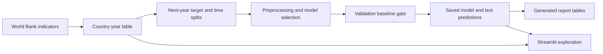
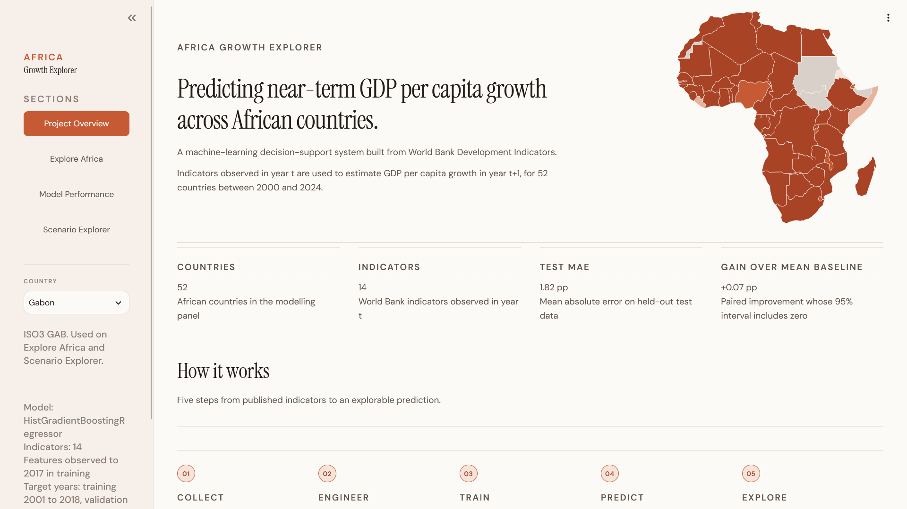

# Africa Growth Explorer

I directed an AI-assisted project that tests whether development indicators improve next-year economic-growth predictions and explains the results in a Streamlit app.

## The problem

I wanted to test whether current development conditions help predict next year's GDP-per-capita growth across African countries, beyond simple historical-average rules. The useful outcome was a limit: reliable improvement was not established on the fixed test period.

## What I built

The repository implements a World Bank indicator pipeline, a country-by-year table, temporal model selection, baseline comparisons, generated report tables and a four-page app for exploration, evaluation and model sensitivity. I chose the question and reviewed the work with AI-assisted coding tools; substantial implementation commits record AI co-authorship.

## Architecture



## How it works

Indicators for year t become inputs for growth in year t+1. Earlier years train the model; later years select settings; the final test covers target years 2022–2024. The app loads committed data and model artifacts rather than retraining. Sliders change model inputs to illustrate sensitivity, not cause and effect.

## ML / AI methodology

The 14 inputs include current growth, income, inflation, investment and development measures. The project compares Ridge (a regularized linear model) with histogram gradient boosting (trees built sequentially to correct errors). Missing-value handling is fitted inside training folds. Temporal cross-validation trains on earlier years and evaluates later ones.

The validation gate compares the candidate with global-average and current-growth rules. A country's historical-average rule is additionally reported on the final test. The saved selected model is gradient boosting, fitted on training rows. Internal early stopping uses a random subset despite the outer temporal protocol.

## Engineering

Configuration-driven data handling, saved model metadata, a baseline gate, generated evidence tables, pytest checks and Streamlit artifact loading exist. Dependencies pin scikit-learn 1.9.0 to match the saved model. Substantial AI co-authorship is part of the development record.

## Results

MAE is mean absolute error, measured in percentage points of growth.

| Final test method | MAE |
|---|---:|
| Gradient-boosted trees | 1.82 |
| Historical global average | 1.90 |
| Current growth | 2.23 |
| Country historical average | 1.94 |

The **0.074 percentage-point** model-versus-average difference had a resampled interval of **−0.0422 to +0.1868**, crossing zero. Reliable uplift was not established. Directional accuracy was **80.7%**, equal to always predicting positive growth.

The committed panel has **1,300 rows, 52 countries and years 2000–2024**. On 13 October 2026, a scratch replay matched all **150 saved test predictions** and metrics exactly. The full suite passed **166 tests**, with one known expected failure for missing country coverage. After matching the library pin in a fresh Windows installation, 48 app/model checks passed without the version warning.

## Demo



This is a repository screenshot. The historical hosted app has not been verified as currently available, so the local app is the supported demonstration. [Report source](reports/capstone_report.md) and [generated evidence](reports/generated/) document the experiment; PDF/deck exports are historical snapshots.

## Run locally

The saved-data path was checked on Windows Python 3.12:

```powershell
python -m venv .venv
.\.venv\Scripts\python.exe -m pip install -r requirements.txt
.\.venv\Scripts\python.exe -m pip install -e ".[dev]"
.\.venv\Scripts\python.exe -m streamlit run app.py
```

For verified checks and scratch reproduction without replacing committed artifacts:

```powershell
.\.venv\Scripts\python.exe -m pytest -q
.\.venv\Scripts\python.exe scripts/finalize_model.py --output-dir work/reproduction
```

Raw-data rebuilding is separate: see [data/README.md](data/README.md). A new World Bank download may differ from the original snapshot.

## Repository structure

- `src/`, `config/`: loading, features, evaluation and app helpers.
- `scripts/`: model selection and report generation.
- `data/processed/`, `models/`: committed panel, model and predictions.
- `app.py`, `assets/`: app and screenshots.
- `reports/`, `presentation/`, `tests/`: evidence, presentation sources and checks.

## Limitations

The raw World Bank download date is missing. Mauritius and Sudan are absent from the panel. Evaluation covers later years for seen countries, not new countries. Row resampling does not account for shared-country or shared-year dependence. Future scenarios are unevaluated illustrations; no causal, policy-impact or adoption claim is supported.

## What I would improve next

1. Record the raw-data vintage and resolve missing-country coverage.
2. Evaluate uncertainty while accounting for country/year dependence.
3. Investigate model stability using a new untouched time period.

## My contribution

I selected the question, directed implementation and visual design, and reviewed modelling decisions and results. The sole human account is mine, but many substantial commits credit an AI coding agent; line-level human authorship cannot be recovered. I do not present all code as exclusively hand-written work. The capstone materials identify the AnalystLab internship programme as project guidance.
